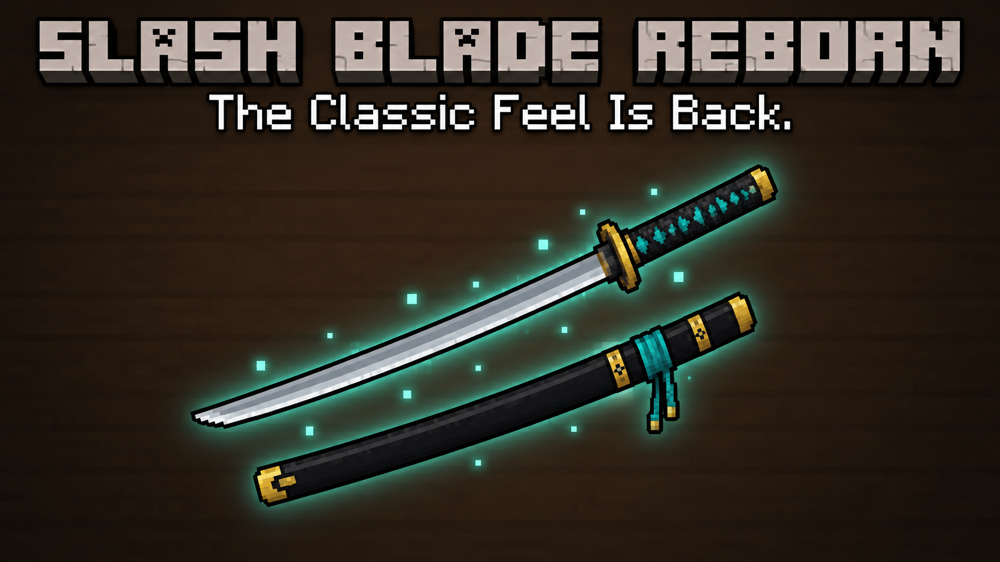

# 拔刀剑：旧梦重铸 / SlashBlade Reborn

SlashBlade: Resharpened 的非官方双端附属。恢复旧版拔刀剑的连段、幻影剑、剑阵、基础 SA、评分、锻造、断刀与修复玩法，并保留现代服务器的伤害保护接口。

此前以 **SEAC拔刀剑附属 旧梦重铸 / SEAC SlashBlade Old Dream Reforged** 名称发布；仓库地址和 modId `slashblade_legacy_compat` 沿用原有标识。

## 下载

| 游戏版本 | 加载器 | 当前开发版 | 下载与更新公告 |
| --- | --- | --- | --- |
| Minecraft 1.21.1 | NeoForge | 0.3.0-dev.10 | [dev.10 预发布](https://github.com/rianfalltwilight-lab/seac-slashblade-old-dream-reforged/releases/tag/v0.3.0-dev.10) |
| Minecraft 1.20.1 | Forge | 0.3.0-dev.16 | [dev.16 预发布](https://github.com/rianfalltwilight-lab/seac-slashblade-old-dream-reforged/releases/tag/mc1.20.1-forge-v0.3.0-dev.16) |

下载对应页面的主 JAR，放入客户端和服务端的 `mods` 文件夹，并移除旧版同名模组。不要把两个游戏版本一起安装。`sources.jar` 和源码 ZIP 供开发使用，测试探针不作为玩家下载包发布。

本次主要改进锁定、穿墙追击、幻影剑碰撞和战斗开销。完整公告：[1.21.1 dev.10](docs/releases/0.3.0-dev.10.md) · [1.20.1 Forge dev.16](docs/releases/mc1.20.1-forge-0.3.0-dev.16.md)。验证环境及边界见 [VALIDATION.md](VALIDATION.md)。

## 源码与构建

- 仓库根目录：Minecraft 1.21.1 / NeoForge，使用 Java 21。运行 `./gradlew --no-daemon build`；开发契约可运行 `./gradlew --no-daemon runContracts`。
- [ports/1.20.1](ports/1.20.1)：Minecraft 1.20.1 移植，Forge 构建方法见该目录 README。

构建依赖按哈希锁定；运行依赖范围以模组元数据为准，不把测试过的加载器补丁版本当作唯一支持版本。SlashBlade: Resharpened 为必需前置。客户端和服务器应使用相同的附属版本。

## 许可证与来源

项目级许可名称为 **MIT-and-Third-Party-Licenses**，完整范围见 [LICENSE.md](LICENSE.md)。独立原创贡献采用 [MIT](LICENSE)，旧版衍生内容保留 [r87 原文](LICENSE-LEGACY17-README.txt) 与 [1.12 原文](LICENSE-LEGACY-README.txt)。参见 [第三方来源](THIRD-PARTY-NOTICES.md)、[NOTICE](NOTICE) 和 [AI 披露](AI-GENERATED.md)。

[CurseForge / Modrinth 项目地址](docs/platform-links.md) · [English](README_en.md)